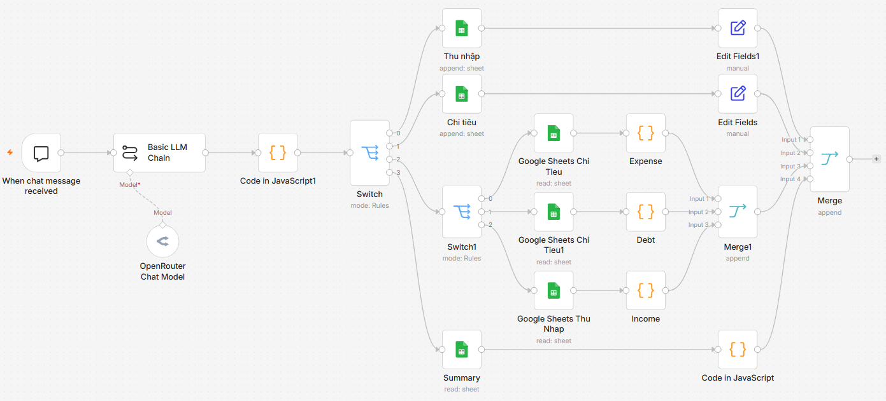

[Tiếng Việt](./README.md) | **English**

# AI-Powered Personal Finance Automation Agent (n8n)

A 24/7 personal finance chat assistant that automates expense tracking, debt logging, and instant balance reporting, eliminating manual spreadsheet entry.

* **n8n Workflow File (ready to import):** [View JSON file here](./workflow/finance_automation_flow.json)

---

### 1. System Architecture


* **Infrastructure:** Self-hosted `n8n` on **Docker Localhost** for full infrastructure control and zero subscription cost.
* **LLM & API:** Integrated **DeepSeek R1** (`deepseek/deepseek-r1`) via **OpenRouter API** acting as a Financial Intent Classifier.
* **Database:** **Google Sheets** structured into 3 sheets (`Income`, `Expense/Debt`, and `Summary`).

---

### 2. Core Pipeline & Logic
1. **Prompt engineering:** Designed a system prompt to classify natural language chat inputs into two primary intents:
   * `write`: Logs new transactions by extracting `Date`, `Content`, `Amount`, `Type`, and `Person`.
   * `read`: Queries historical records, split into `summary` (overall balance dashboard) and `history` (detailed breakdown by `income`, `expense`, or `debt`).
2. **Data cleaning & Fallback handling in JavaScript (`Code in JavaScript1`):**
   * Strips Markdown fences (` ```json `) commonly returned by LLMs.
   * Extracts JSON blocks via Regex with `try/catch` error handling (`error` / `chat_only` fallbacks) to prevent workflow crashes.
   * Normalizes string fields (`Loai_Slug`) for reliable downstream routing.
3. **Routing & Instant reporting:**
   * `Switch` nodes route write operations to the corresponding Google Sheets tabs.
   * For read queries, dedicated JavaScript nodes (`Expense`, `Debt`, `Income`, `Summary`) filter records, aggregate totals, format VND currency, and merge responses back to the chat interface.

---

### 3. Quick setup
1. Deploy `n8n` (Docker recommended).
2. Download `finance_automation_flow.json` from the `workflow/` folder and import it into n8n.
3. Configure your **OpenRouter API** and **Google Sheets OAuth2** credentials, then update the Sheet IDs in the Google Sheets nodes.
