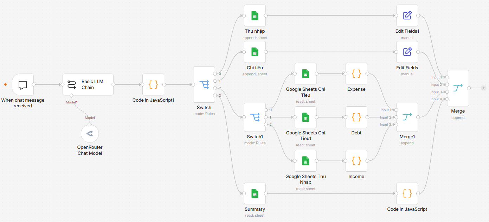

**Tiếng Việt** | [English](./README.en.md)

# Hệ thống quản lý tài chính cá nhân tự động qua AI agent (n8n)

Xây dựng trợ lý ảo tài chính hoạt động 24/7 giúp ghi chép thu chi, sổ nợ và tra cứu báo cáo số dư tức thì trực tiếp qua khung chat, thay thế hoàn toàn việc nhập liệu thủ công.

* **File Workflow n8n (import trực tiếp):** [Xem file JSON tại đây](./workflow/finance_automation_flow.json)

---

### 1. Kiến trúc hệ thống


* **Hạ tầng:** Tự triển khai `n8n` trên môi trường **Docker Localhost** để chủ động vận hành và tối ưu chi phí.
* **AI & API:** Tích hợp mô hình **DeepSeek R1** (`deepseek/deepseek-r1`) thông qua **OpenRouter API** để phân loại ý định người dùng (Financial Intent Classifier).
* **Database:** Sử dụng **Google Sheets** gồm 3 trang tính riêng biệt (`Thu nhập`, `Chi tiêu` - bao gồm cả sổ nợ, và `Tổng kết`).

---

### 2. Quy trình xử lý cốt lõi
1. **Prompt engineering:** Thiết kế System Prompt phân tách rõ 2 nhánh ý định chính từ tin nhắn tự nhiên của người dùng:
   * `write`: Ghi nhận giao dịch mới (tự động bóc tách `ThoiGian`, `Noi_Dung`, `So_Tien`, `Loai`, `Nguoi`).
   * `read`: Tra cứu dữ liệu, chia tiếp thành `summary` (xem tổng kết số dư) và `history` (lọc chi tiết theo `income`, `expense`, `debt`).
2. **Xử lý lỗi & Chuẩn hóa dữ liệu bằng JavaScript (`Code in JavaScript1`):**
   * Tự động loại bỏ thẻ Markdown (` ```json `) mà LLM thường trả về kèm theo.
   * Dùng Regex trích xuất khối JSON và bọc trong `try/catch` để trả về nhánh dự phòng (`error` / `chat_only`), đảm bảo workflow không bị sập khi AI trả lời lệch format.
   * Chuẩn hóa dữ liệu chữ thường (`Loai_Slug`) để node `Switch` phía sau điều hướng chính xác.
3. **Điều hướng & Tổng hợp báo cáo:**
   * Node `Switch` tự động chia luồng ghi dữ liệu vào đúng Sheet `Thu nhập` hoặc `Chi tiêu`.
   * Với nhánh tra cứu, hệ thống đọc dữ liệu từ Google Sheets, dùng các node JavaScript riêng (`Expense`, `Debt`, `Income`, `Summary`) để lọc, cộng dồn tổng tiền, định dạng lại tiền tệ VND và gộp kết quả trả về qua node `Merge`.

---

### 3. Hướng dẫn chạy thử
1. Cài đặt và khởi chạy `n8n` (khuyên dùng qua Docker).
2. Tải file `finance_automation_flow.json` trong thư mục `workflow/` và import vào n8n.
3. Cấu hình lại Credentials cho **OpenRouter API** và **Google Sheets OAuth2**, sau đó gắn ID file Google Sheets của bạn vào các node Google Sheets tương ứng.
